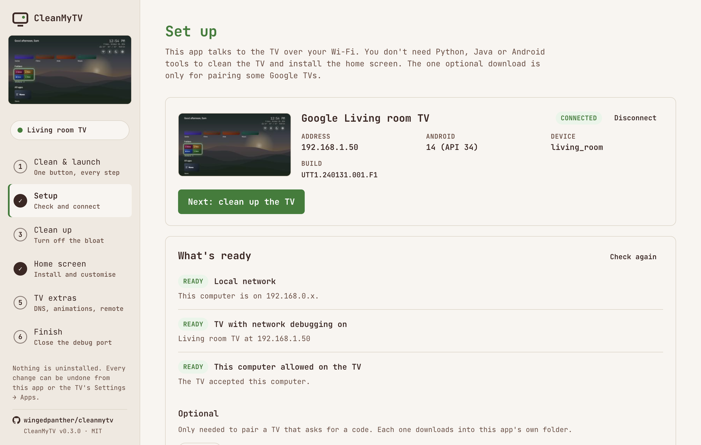
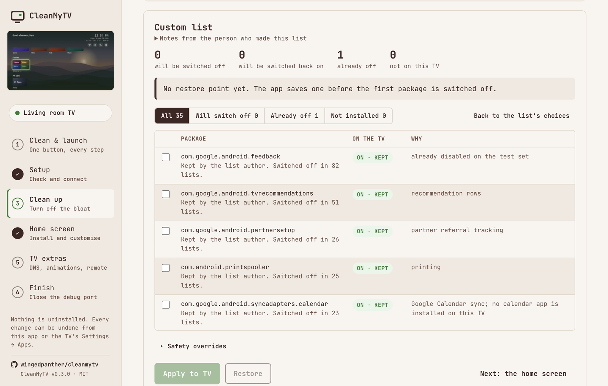
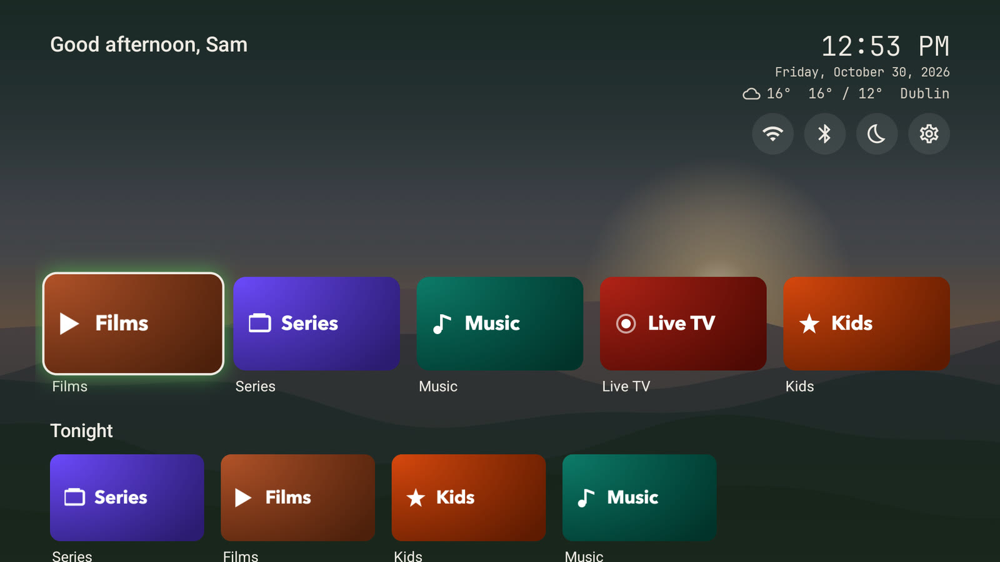
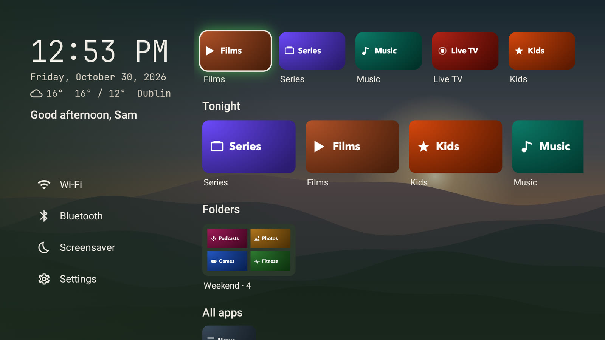
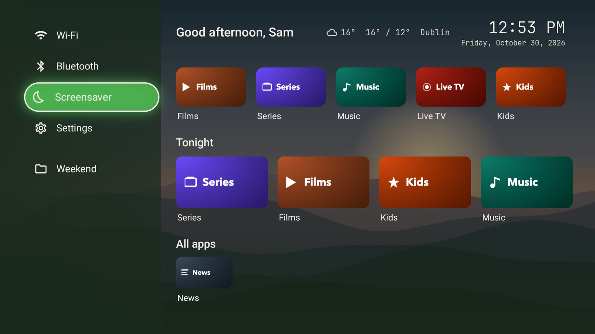
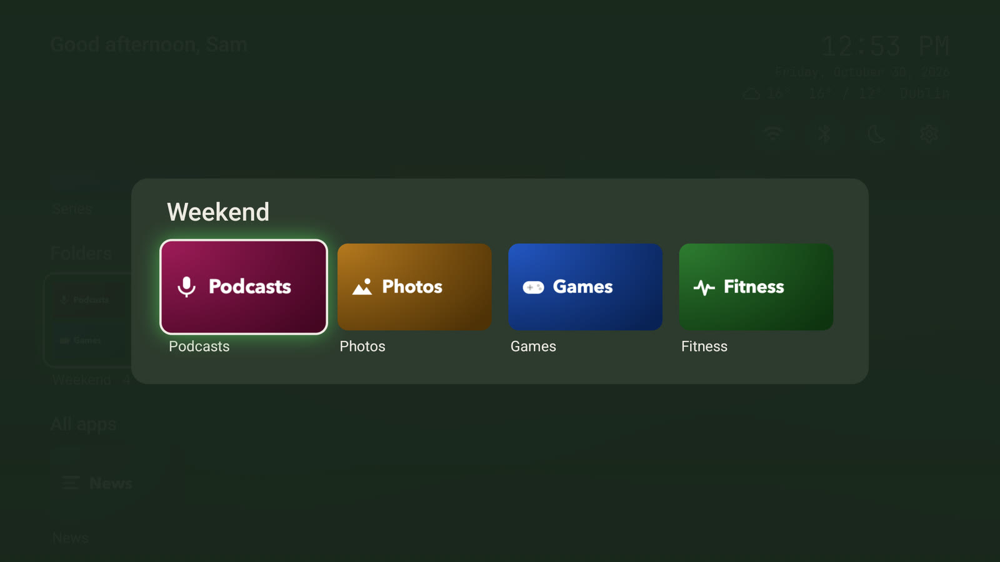
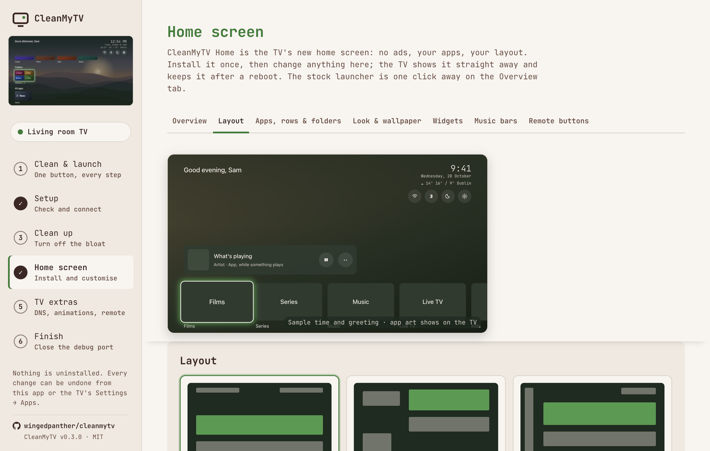

# CleanMyTV

A free Mac and Windows app that cleans up your Android TV over Wi-Fi. It switches off the preinstalled
bloat and puts in CleanMyTV Home, an ad-free home screen you set up from your computer. You don't need
Python, Java, Android Studio or `adb`.

The per-TV cleanup lists come from [cleanyourtv](https://github.com/Gathin23/cleanyourtv) by
[@gathint](https://x.com/gathint). Thanks, Gathin.

New to this? The **[user guide](docs/USER-GUIDE.md)** walks every step at TV-owner pace, including
rollback and troubleshooting, and the **[known-devices table](docs/KNOWN-DEVICES.md)** shows what the
bundled lists cover per model. This README is the technical overview.

Questions, help and home-screen setups: join the **[CleanMyTV Discord](https://discord.gg/6hZeQkDYf9)**.
Bugs and feature requests go to [GitHub issues](https://github.com/wingedpanther/cleanmytv/issues).


https://github.com/user-attachments/assets/4e3eb18a-d196-4a51-8d0e-93ce98e11913


## Download and install

Get the latest version from [Releases](https://github.com/wingedpanther/cleanmytv/releases):

| Computer | File |
|---|---|
| Mac with Apple silicon (M1 and later) | `CleanMyTV-<version>-arm64.dmg` |
| Mac with Intel | `CleanMyTV-<version>.dmg` |
| Windows 10 or 11 | `CleanMyTV-Setup-<version>.exe` |

Macs need macOS 13 Ventura or newer. The app asks GitHub for a newer version at most twice a day and
links to it in the sidebar; it never downloads anything by itself.

The installers are not signed with a paid developer certificate, so your computer warns you the first
time:

- **Mac:** open the dmg and drag CleanMyTV to Applications, then open it. When macOS says it can't
  verify the developer, choose **Done**, go to System Settings → Privacy & Security and press
  **Open Anyway** next to CleanMyTV (on macOS 14 and earlier, right-click the app and choose **Open**
  instead). macOS asks whether CleanMyTV may find devices on your local network: choose **Allow**, or
  it cannot reach the TV.

  If macOS says CleanMyTV **is damaged and can't be opened**, you have v0.1.0, whose Mac build was
  not signed correctly. Run this in Terminal, then open the app again:

  ```bash
  xattr -cr /Applications/CleanMyTV.app
  codesign --force --deep --sign - /Applications/CleanMyTV.app
  ```
- **Windows:** when SmartScreen says it protected your PC, choose **More info**, then **Run anyway**.

## Before you start: on the TV

1. Settings → Device Preferences → About (on some Google TVs: Settings → System → About).
2. Press OK on **Build** (or **Android TV OS build**) seven times, until the TV says you are a developer.
3. Back one screen → **Developer options** → turn on **USB debugging**. If you also see
   **Network debugging** or **ADB debugging**, turn that on too.
4. Keep the TV on and on the same Wi-Fi as your computer.

Open CleanMyTV, find the TV and choose **Allow** when the TV asks. Tick **Always allow from this
computer** to skip the question next time.

## What it does

| Step | What happens |
|---|---|
| **Clean & launch** | The guided path: applies the list that best matches your TV, then installs CleanMyTV Home. |
| **Setup** | Checks the network, finds TVs with port 5555 open, connects, and waits while you press Allow on the TV. Google TVs that only offer Wireless debugging get a pairing form. With more than one known TV, it shows them with snapshot thumbnails to pick from. |
| **Clean up** | Picks the upstream list that matches your TV's model, from 371 TVs and 100 brands. Every package shows its live state on the TV, and you choose what to disable. If your TV isn't listed, lists from its brand come first, and it offers the packages other TVs disable. You can add any package on the TV by name. |
| **Home screen** | Installs or updates CleanMyTV Home and hands Home over. If Home doesn't land on it, it rolls back. If the app can't tell which app is the TV's own launcher, it asks. Tabs for layout, apps, rows and folders, look and wallpaper, widgets, music bars and remote buttons. See below. |
| **TV extras** | Ad-blocking Private DNS, animation speed, an on-screen remote, reboot. |
| **Finish** | Restarts the TV and checks the home screen comes back; if it doesn't, puts the stock launcher back. Then walks through switching debugging off, and checks that port 5555 is closed. |

| | |
|---|---|
|  |  |

Nothing is uninstalled. Packages are switched off for your user, and Restore puts every package back
the way it was before the first cleanup.

## CleanMyTV Home

No ads. Your apps, your layout, the weather and what's playing. You change everything from your
computer, and the TV shows it as you click.

| | |
|---|---|
|  |  |
| **Shelf**, the default | **Split** |
|  |  |
| **Rail**, opened | A folder |



The Home screen step has seven tabs. Every change shows on the TV straight away. The Layout and Apps
tabs have a live preview of the TV screen at the top.

| Tab | What you set |
|---|---|
| **Overview** | Install or update Home, and how to use it. Give Home back to the stock launcher. Remove the old CleanYourTV launcher in one click if it's still on the TV. Take a snapshot of the TV screen. |
| **Layout** | Three layouts: Shelf (the default), Split and Rail. Space above the apps. The now playing, dock, rows, folders and all apps sections, in any order, each one can be hidden. Quick-settings icons: Inputs, Wi-Fi, Bluetooth, Picture & sound, Apps, Screensaver, Search, Music bars and Settings. Icons the TV can't open are marked "not on this TV". Dock and row tile sizes, apps per row, app names, clock and greeting. |
| **Apps, rows & folders** | Dock size, drag to reorder, hide apps, named rows and folders. |
| **Look & wallpaper** | Accent colour, focus style (glow, outline or none), your own picture or Bing's picture of the day, darken, background colour. |
| **Widgets** | Now playing: what any music or video app plays, with play, pause and next. Weather next to the clock for a town you pick, in °C or °F. |
| **Music bars** | On or off; bars, mirrored or wave; accent, rainbow or white; peak dots, number of bars, height, opacity and sensitivity. |
| **Remote buttons** | Find what a remote button sends, then give it a job in every app: open Settings, Inputs, an app, Home, Back, and more. Off until you turn it on. Only the buttons you map are touched. Power, volume and the mic button are usually handled before Android sees them. On Xiaomi TVs, one click makes the Mi button go Home. |

Your settings and wallpaper stay through updates and reboots. The app also keeps a copy on your
computer: if CleanMyTV Home ever starts empty (after an uninstall or a factory reset), installing it
puts the copy back. What the launcher can access is under [Security and privacy](#security-and-privacy).

CleanMyTV Home needs Android 9 (API 28) or newer.

## Coming back to customise

Turn USB debugging on again and open the app. With one known TV, it reconnects to it. When CleanMyTV
Home is already Home it opens the Home screen step, loaded with what is on the TV now. Switch debugging
off again when you're done. If you didn't revoke the authorisations, there's no Allow prompt.

The app remembers each TV it has connected to. With more than one, it doesn't connect by itself: Setup
shows the TVs with snapshot thumbnails, and you pick one. The sidebar shows the connected TV's thumbnail.

If the router gave the TV a new address, or another device now answers at the old one, the app says so
and scans the network. You pick the TV from the list; the app does not log in to devices it found by
itself.

## Security and privacy

- **What it talks to.** The TV address you choose, over ADB on port 5555 of your local network. Over
  HTTPS, and nothing else:
  - api.github.com, at most twice a day, to see if a newer CleanMyTV is out. It downloads nothing.
  - dl.google.com for Google's platform-tools, only when you click it (Wireless debugging pairing).
  - www.bing.com, only when you choose Bing's picture of the day as the wallpaper.
  - geocoding-api.open-meteo.com, only when you search for a town for the weather.

  No analytics, no accounts, no server of its own.
- **What CleanMyTV Home can access.**
  - Its settings and wallpaper live in its own private storage. The app sends them over ADB through a
    ContentProvider (`content call`) that only the shell user and root may call. This is also what
    fixed the "Permission denied" on `Android/data` (#20, #27, #28) and the reset after a reboot (#21).
  - The music bars read the TV's sound output: the app grants `RECORD_AUDIO` over ADB at install. The
    bars only move while music or video plays.
  - Now playing reads other apps' media sessions. Android only allows that for a notification listener,
    so the app switches one on over ADB while the section is on, and off without it. It reads no
    notifications.
  - Remote buttons use an accessibility service. It sees key presses and which app is in front, and
    can't read what's on screen. It is off until you turn it on, and only acts on the buttons you map.
  - The only thing it fetches from the internet is the weather, from api.open-meteo.com, every 30
    minutes while the place is set.
- **Your keys.** The app makes its own ADB key in its data folder and signs only with that. It never
  uses `~/.android/adbkey`, which your phones may also trust, and it only logs in to an address you
  picked. Network ADB is plaintext by design, so use it on a network you trust.
- **Pinned upstream.** The debloat lists come from one upstream commit pinned in
  [`upstream.json`](upstream.json) with a content hash. A build refuses anything that doesn't match, so
  a change upstream reaches this app only after someone reviews it and moves the pin.
- **The launcher signing key ships inside the app, on purpose.** `resources/signing/cleanmytv.jks`
  (password `cleanyourtv`) signs CleanMyTV Home, so every build installs over the others. It gives no
  access to a TV: installing anything still needs ADB access the owner allowed.
- **Close debugging when you're done.** Some TVs (`ro.adb.secure=0`) accept any device on the network
  without the Allow prompt; the app warns you if yours is one. The Finish step checks that port 5555 is
  closed. The launcher keeps working without debugging.
- **Window lockdown.** The app window is sandboxed, cannot navigate away from its own page, and only
  that page may call into the part that talks to the TV.

Found a security problem? Please report it privately through the repository's
**Security → Report a vulnerability** page rather than in a public issue.

## Credits and upstream

The per-TV cleanup lists are [cleanyourtv](https://github.com/Gathin23/cleanyourtv)'s, by
[@gathint](https://x.com/gathint), shipped unchanged. CleanMyTV is an independent project, not part of
cleanyourtv. Versions 0.1.x installed the CleanYourTV launcher (`com.gathin.tvhome`); since 0.2.0 the
launcher is CleanMyTV Home, built from `home/` in this repository, and the app can remove the old one.

The debloat side is a TypeScript port of upstream's `tools/`, and the launcher handover follows
`launcher/build-and-install.sh`:

- `src/main/adb/` is an ADB-over-TCP client, the twin of `tools/tv.py`.
- `src/main/debloat.ts` has the same guards as `disable.sh`: it won't disable the app that owns Home while nothing else can take it, and it won't disable setupwraith while it owns the Wi-Fi network. It writes the same recovery record to `~/.cleanyourtv/`, plus the TV's device name so the record follows the TV to a new address. `tests/engine.test.ts` checks that the record names and the restore batch match upstream `recovery.py` exactly, so `tools/restore.sh ~/.cleanyourtv/lists/<tv>.txt` can also undo what the app did.
- `src/main/launcher.ts` follows the handover order of `build-and-install.sh`: install, start, switch off Google's launcher, set Home, check, roll back. Vendor launchers stay on, as upstream's `STOCK_LAUNCHER=none` does: lists say to keep them. The app knows the stock launchers the lists name, and remembers each TV's for Undo. It also removes the CleanYourTV launcher that 0.1.x installed.
- `src/main/home.ts` reads and writes CleanMyTV Home's settings through its ContentProvider.

Upstream's themes aren't bundled. They are for upstream's launcher.

### The launcher APK

CleanMyTV Home lives in `home/`: Kotlin and Jetpack Compose for TV, package
`io.github.wingedpanther.cleanmytv.home`. `npm run home` builds it into `resources/home.apk`, and
`resources/home.json` records its version. The script uses `JAVA_HOME` and `ANDROID_HOME` if they are
set. Otherwise it downloads JDK 17 and the Android SDK into `.cytv-build/`. Every build is signed with
`resources/signing/cleanmytv.jks`, so each one installs over the others.

## Develop

```bash
npm install
npm run sync                 # lists from the pinned upstream commit
npm run home                 # resources/home.apk (without JAVA_HOME/ANDROID_HOME, first run downloads the build tools)
npm run dev                  # the app, with hot reload
npx tsx scripts/fake-tv.ts   # a pretend TV on 127.0.0.1:5556 to try the app without one
UPSTREAM_DIR=<clone at the pinned commit> npm test
npm run dist:mac             # dist/*.dmg   (on a Mac)
npm run dist:win             # dist/*.exe   (on Windows, a Mac, or in CI)
```

To move to a newer upstream: review its changes, then `node scripts/pin-upstream.mjs <commit sha>`,
`npm run sync`, and test on a TV. `UPSTREAM_UNPINNED=1` lets `sync` use other content for a local
trial.

`.github/workflows/build.yml` builds the APK on Linux and runs the tests on every push and pull request.
Pushes to `main` and version tags also build the macOS and Windows installers; download them from the
run's **Artifacts**. It runs with read-only repository permissions and actions pinned to commits.

### Releasing

1. Set the new `version` in `package.json` and commit it.
2. Tag and push: `git tag v0.3.0 && git push origin main v0.3.0`.
3. The workflow builds both installers and opens a **draft** release with them attached. Check it,
   then press **Publish release**.

The tag has to match the version in `package.json`, or the release step stops.

## Help and community

- **Chat and how-to questions:** the [CleanMyTV Discord](https://discord.gg/6hZeQkDYf9). Share your
  home screen in `#show-your-setup`.
- **Bugs and feature requests:** [open a GitHub issue](https://github.com/wingedpanther/cleanmytv/issues/new)
  with your TV model, Android version and what happened. Issues are where fixes get tracked, so please
  don't report bugs only in Discord.

## Known limits

- Tested on a Xiaomi Mi Box S from Windows, and on a TV emulator from macOS.
- Macs need macOS 13 Ventura or newer. CleanMyTV Home needs Android 9 or newer; Clean up works on older TVs.
- Wireless debugging pairing uses Google's `adb`, downloaded on demand. On macOS, Local Network
  privacy can block that binary. If pairing fails there, pair from a Windows PC or run `adb pair`
  in Terminal once.

## Licence

MIT, see [LICENSE](LICENSE). The bundled debloat lists are from
[cleanyourtv](https://github.com/Gathin23/cleanyourtv) by Gathin23, also MIT; its licence ships in
`resources/upstream/LICENSE`.
