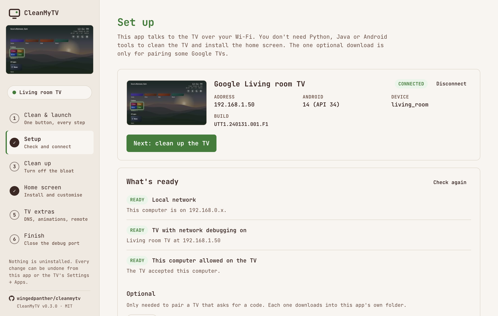
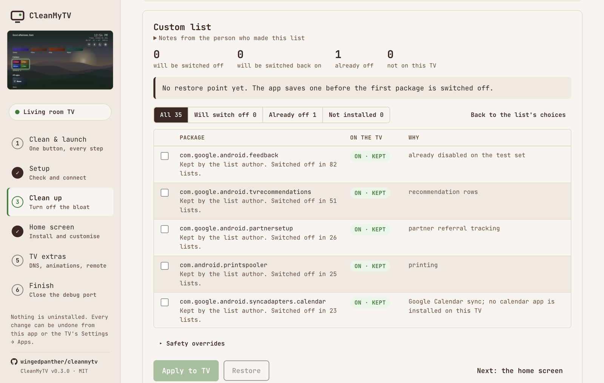
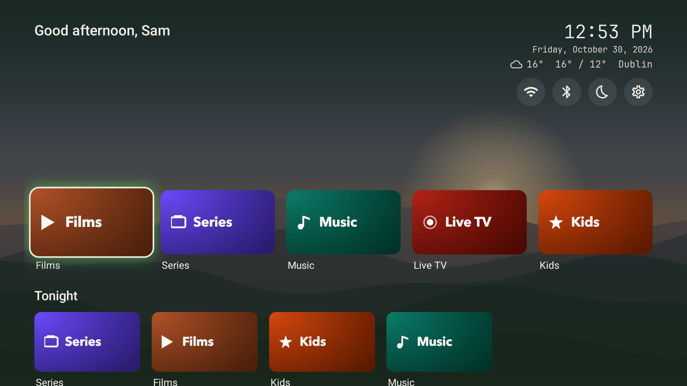
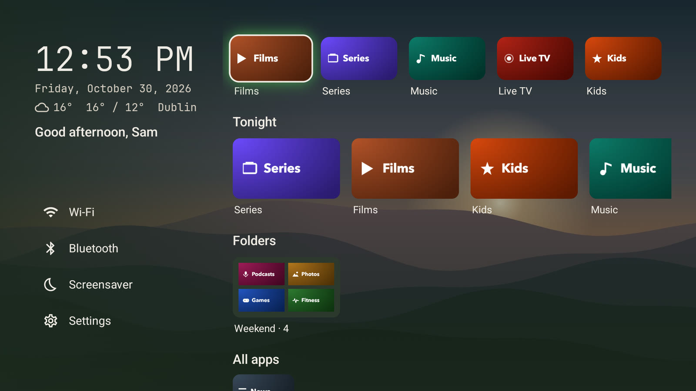
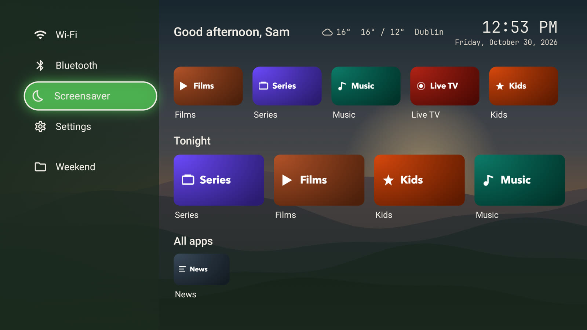
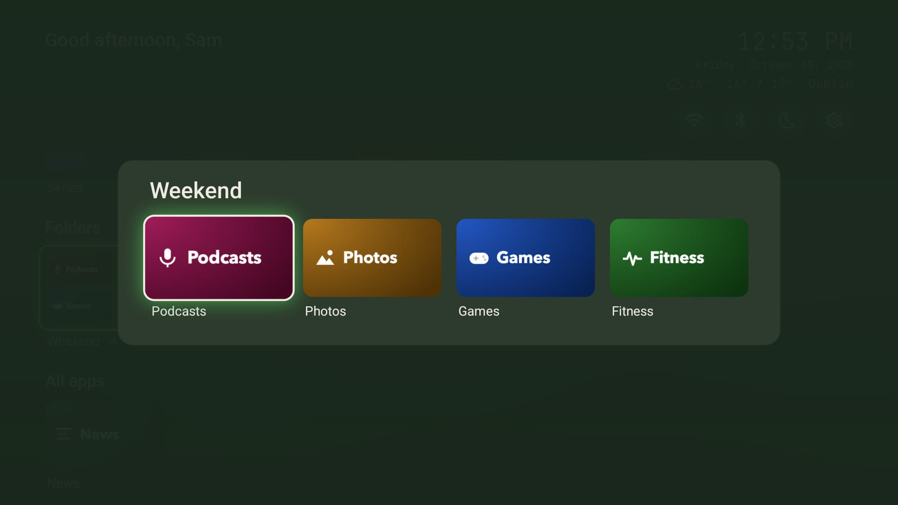
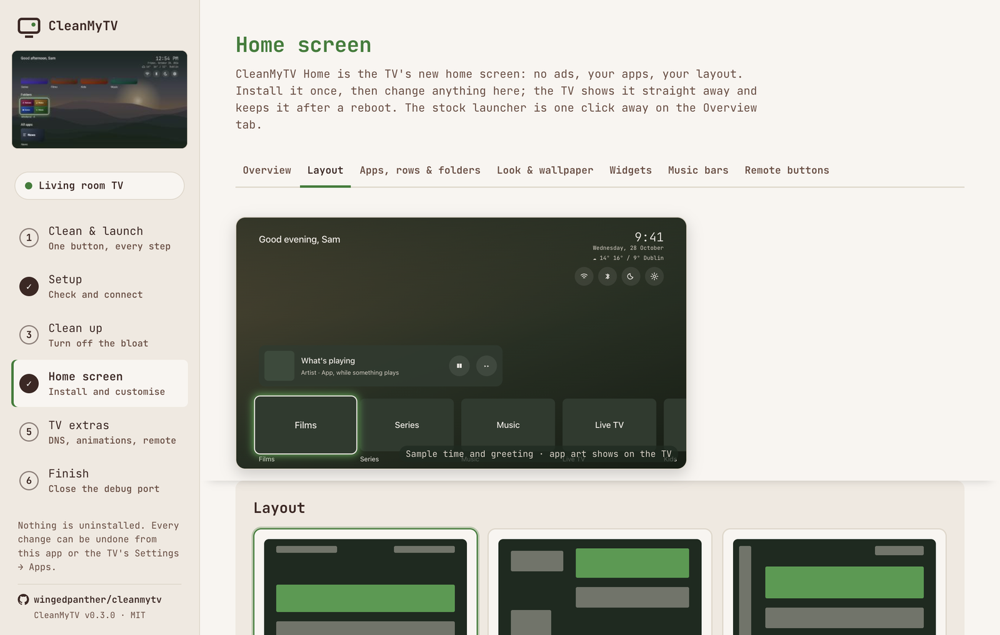

# CleanMyTV

A free Mac, Windows and Linux app that cleans up your Android TV over Wi-Fi. It switches off the preinstalled
bloat and puts in CleanMyTV Home, an ad-free home screen you set up from your computer. You don't need
Python, Java, Android Studio or `adb`.

The per-TV cleanup lists come from [cleanyourtv](https://github.com/Gathin23/cleanyourtv) by
[@gathint](https://x.com/gathint). Thanks, Gathin.

New to this? The **[user guide](docs/USER-GUIDE.md)** walks every step at TV-owner pace, including
rollback and troubleshooting, and the **[known-devices table](docs/KNOWN-DEVICES.md)** shows what the
bundled lists cover per model. This README is the technical overview.

Questions, help and home-screen setups: join the **[CleanMyTV Discord](https://discord.gg/6hZeQkDYf9)**.
Bugs and feature requests go to [GitHub issues](https://github.com/wingedpanther/cleanmytv/issues).
If CleanMyTV made your TV nicer to use, you can [buy me a coffee](https://buymeacoffee.com/wingedpanther).

### New in 0.13.4

- **Hold a button for a second job:** each remote button can do one thing when pressed and another
  when held down, set in Remote buttons on the TV or here.
- **Inputs as tiles:** each HDMI port can become a tile named as the Inputs menu names it, like PS5.
  Put it in the dock or a row, and one press switches to it.
- **Bedtime:** the TV turns off at a set time on the days you pick. A minute before, a note says so,
  and any button keeps it on for the night.
- **Apps that came back:** system updates often switch the bloat back on. Clean up now says when that
  happened and switches them off again in one click. CleanMyTV Home says so on the TV too.
- **Storage:** TV extras lists the apps taking the most space, and can remove updates from switched-off
  apps.
- **Back up the TV:** save the clean-up choices and Home's settings to a file, and restore them after a
  factory reset or on another TV.
- **Send a report:** one button in Activity saves a text file with what a bug report needs, ready to
  attach to a GitHub issue.
- **Check for updates (#133):** a button in the sidebar, and the app now checks every time it starts.
- **XGIMI projectors (#127):** picking an HDMI port switches straight to it.

Older releases: the [changelog](docs/CHANGELOG.md) or the [Releases page](https://github.com/wingedpanther/cleanmytv/releases).

## Download and install

Get the latest version from [Releases](https://github.com/wingedpanther/cleanmytv/releases):

| Computer | File |
|---|---|
| Mac with Apple silicon (M1 and later) | `CleanMyTV-<version>-arm64.dmg` |
| Mac with Intel | `CleanMyTV-<version>.dmg` |
| Windows 10 or 11 | `CleanMyTV-Setup-<version>.exe` |
| Linux (64-bit) | `CleanMyTV-<version>.AppImage` |

Macs need macOS 13 Ventura or newer, and Windows needs Windows 10 or 11 on a 64-bit PC. The app asks GitHub
for a newer version at most twice a day. On a Mac or Windows, **Update now** in the sidebar downloads it,
checks it against the release's checksums and installs it; on Linux, download the new AppImage.

Each release also has `CleanMyTV-Home-<version>.apk`, the launcher on its own. Installed over CleanMyTV Home
on the TV (with Downloader, for example), it keeps your settings.

The installers are not signed with a paid developer certificate, so your computer warns you the first
time:

- **Mac:** open the dmg and drag CleanMyTV to Applications, then open it. When macOS says it can't
  verify the developer, choose **Done**, go to System Settings → Privacy & Security and press
  **Open Anyway** next to CleanMyTV (on macOS 14 and earlier, right-click the app and choose **Open**
  instead). macOS asks whether CleanMyTV may find devices on your local network: choose **Allow**, or
  it cannot reach the TV.

  If macOS says CleanMyTV **is damaged and can't be opened**, you have v0.1.0, whose Mac build was
  not signed correctly. Run this in Terminal, then open the app again:

  ```bash
  xattr -cr /Applications/CleanMyTV.app
  codesign --force --deep --sign - /Applications/CleanMyTV.app
  ```
- **Windows:** your browser may call the download uncommon, or even dangerous, because the installer is
  new and not signed. Keep it: in Chrome, open the downloads list and choose **Keep**. When SmartScreen
  says it protected your PC, choose **More info**, then **Run anyway**.
- **Linux:** make the downloaded file executable (`chmod +x CleanMyTV-*.AppImage`) and run it. Ubuntu
  22.04 and newer do not ship FUSE 2 by default, which AppImages need: install `libfuse2t64` (Ubuntu 24.04+)
  or `libfuse2` (Ubuntu 22.04) first (`sudo apt install libfuse2t64` or `sudo apt install libfuse2`).

## Before you start: on the TV

1. Settings → Device Preferences → About (on some Google TVs: Settings → System → About).
2. Press OK on **Build** (or **Android TV OS build**) seven times, until the TV says you are a developer.
3. Back one screen → **Developer options** → turn on **USB debugging**. If you also see
   **Network debugging** or **ADB debugging**, turn that on too.
4. Keep the TV on and on the same Wi-Fi as your computer.

Open CleanMyTV, find the TV and choose **Allow** when the TV asks. Tick **Always allow from this
computer** to skip the question next time.

## What it does

| Step | What happens |
|---|---|
| **Clean & launch** | The guided path: applies the list that best matches your TV, then installs CleanMyTV Home. |
| **Setup** | Checks the network, lists the TVs on your Wi-Fi by name (a phone with Wireless debugging on can show up too, and a scan finds older TVs with port 5555 open), connects, and waits while you press Allow on the TV. Google TVs that only offer Wireless debugging get a pairing form that fills in the ports when the TV's pairing screen opens, so you only type the code. With more than one known TV, it shows them with snapshot thumbnails to pick from. |
| **Clean up** | Picks the upstream list that matches your TV's model, from 472 TVs and 129 brands. Every package shows its live state on the TV, and you choose what to disable. If your TV isn't listed, lists from its brand come first, and it offers the packages other TVs disable. You can add any package on the TV by name. |
| **Home screen** | Installs or updates CleanMyTV Home and hands Home over. If Home doesn't land on it, it rolls back. If the app can't tell which app is the TV's own launcher, it asks. Tabs for layout, apps, rows and folders, look and wallpaper, widgets, music bars and remote buttons. See below. |
| **TV extras** | Ad-blocking Private DNS, animation speed, an on-screen remote, reboot. |
| **Finish** | Restarts the TV and checks the home screen comes back; if it doesn't, puts the stock launcher back. Then walks through switching debugging off, and checks that port 5555 is closed. |

| | |
|---|---|
|  |  |

Nothing is uninstalled. Packages are switched off for your user, and Restore puts every package back
the way it was before the first cleanup.

## CleanMyTV Home

No ads. Your apps, your layout, the weather and what's playing. You change everything from your
computer, and the TV shows it as you click. Or, with **Edit on the TV** switched on, from the TV with the
remote: a Customize icon in the top bar opens the same settings, with a search to find them.

| | |
|---|---|
|  |  |
| **Shelf**, the default | **Split** |
|  |  |
| **Rail**, opened | A folder |



The Home screen step has eight tabs. Every change shows on the TV straight away. The Layout and Apps
tabs have a live preview of the TV screen at the top.

| Tab | What you set |
|---|---|
| **Overview** | Install or update Home, and how to use it. Give Home back to the stock launcher. Remove the old CleanYourTV launcher in one click if it's still on the TV. Take a snapshot of the TV screen. |
| **Layout** | Three layouts: Shelf (the default), Split and Rail. Space above the apps. The now playing, dock, continue watching, rows, folders and all apps sections, in any order, each one can be hidden. Quick-settings icons: Inputs, Wi-Fi, Bluetooth, Picture & sound, Apps, Screensaver, Search, Music bars, Quick settings, Themes, Fireplace and Settings. Icons the TV can't open are marked "not on this TV". Up to 6 apps as round icons in the same row, like a VPN. Dock and row tile sizes, apps per row, app names (always, focused app only, or off), clock and greeting. An idle screen: after a set time with no button pressed, only the wallpaper and a large clock show. |
| **Apps, rows & folders** | Dock size, drag to reorder, hide apps, named rows and folders. |
| **Look & wallpaper** | Themes: 29 looks with their own wallpaper art, three pictures each, saved to and loaded from `.cmtvtheme` files, and Put it back to undo them. Put the themes on the TV to switch them with the remote. App icons: banners, or every logo redrawn in Colour, Mono or Duotone, on wide, square, squircle or round tiles. Accent colour. Focus style (lift, glow, outline or none), with options to lean the tile toward the move, keep it in place while the row slides, and tint the background in the focused app's colour. Your own picture or Bing's picture of the day, darken, background colour, and the sunrise when it changes. Snow falling over the wallpaper, on its own switch; the Christmas theme turns it on. A slideshow of up to 12 pictures. Make your own theme from a built-in one. The fireplace: put it on the TV, show it, make it the screensaver or put it behind Home, with its crackle and a turn-off timer. |
| **Widgets** | Now playing: what any music or video app plays, with play, pause and next. Weather next to the clock for a town you pick, in °C or °F. |
| **Music bars** | On or off; bars, mirrored or wave; accent, rainbow or white; peak dots, number of bars, height, opacity and sensitivity. |
| **Remote buttons** | Find what a remote button sends, then give it a job in every app: open Settings, Inputs, an app, Home, Back, Quick settings, Themes, the fireplace, the theme's next picture, and more. Off until you turn it on. Only the buttons you map are touched. Power, volume and the mic button are usually handled before Android sees them. On Xiaomi TVs, one click makes the Mi button go Home. |
| **App lock** | A 4 to 6 digit PIN, kept hashed on the TV, and the apps it locks. Optionally Settings, the Play Store and Quick settings too. An unlock lasts until the TV sleeps, 15 minutes, or until another app opens. Locked apps show a small lock on Home, or stay hidden. One switch turns it all off; the PIN and the list stay. |

Your settings and wallpaper stay through updates and reboots. The app also keeps a copy on your
computer: if CleanMyTV Home ever starts empty (after an uninstall or a factory reset), installing it
puts the copy back. The wallpaper is also kept on the TV, so another computer can save the look with it. What the launcher can access is under [Security and privacy](#security-and-privacy).

CleanMyTV Home needs Android 8 (API 26) or newer.

## Coming back to customise

Turn USB debugging on again and open the app. With one known TV, it reconnects to it. When CleanMyTV
Home is already Home it opens the Home screen step, loaded with what is on the TV now. Switch debugging
off again when you're done. If you didn't revoke the authorisations, there's no Allow prompt.

The app remembers each TV it has connected to. With more than one, it doesn't connect by itself: Setup
shows the TVs with snapshot thumbnails, and you pick one. The sidebar shows the connected TV's thumbnail.

If the router gave the TV a new address, or another device now answers at the old one, the app says so
and scans the network. You pick the TV from the list; the app does not log in to devices it found by
itself.

## Security and privacy

- **What it talks to.** The TV address you choose, over ADB on port 5555 of your local network. On
  Setup, it also asks your local network which Android TVs are there (mDNS) and checks whether their
  debugging ports accept a connection, without logging in. Over HTTPS, and nothing else:
  - api.github.com, at most twice a day, to see if a newer CleanMyTV is out. It downloads nothing.
  - dl.google.com for Google's platform-tools, only when you click it (Wireless debugging pairing).
  - www.bing.com, only when you choose Bing's picture of the day as the wallpaper.
  - geocoding-api.open-meteo.com, only when you search for a town for the weather.
  - github.com, once, when you press Put the fireplace on the TV. It downloads the video and sound from
    this project's `fireplace-1` release and checks them against a fixed SHA-256.

  No analytics, no accounts, no server of its own.
- **What CleanMyTV Home can access.**
  - Its settings and wallpaper live in its own private storage. The app sends them over ADB through a
    ContentProvider (`content call`) that only the shell user and root may call. This is also what
    fixed the "Permission denied" on `Android/data` (#20, #27, #28) and the reset after a reboot (#21).
  - The music bars read the TV's sound output: the app grants `RECORD_AUDIO` over ADB at install. The
    bars only move while music or video plays.
  - Now playing reads other apps' media sessions. Android only allows that for a notification listener,
    so the app switches one on over ADB while the section is on, and off without it. It reads no
    notifications.
  - Continue watching reads Android's Watch Next list, the one Google TV's launcher shows. Android only
    shows Home other apps' entries with `READ_TV_LISTINGS`, which the app grants over ADB at install. A
    Home that updated itself asks on the TV, in the editor's Layout section.
  - Remote buttons and the app lock use an accessibility service. It sees key presses and which app is
    in front. To keep Fire TV Settings open when Amazon displays them inside its Home activity, the
    service can access window layouts. It requests content changes, focus events and view IDs only while
    Amazon Home redirection is enabled. It checks the visibility of Amazon Settings controls without
    reading or logging their text. The service runs when features such as remote buttons, app lock or
    Home redirection are enabled. It only handles buttons you map and locks apps you choose.
  - The app lock's PIN is stored on the TV salted and hashed (PBKDF2), in Home's private storage. The
    app can set it but never read it back. It's a family lock: anyone with ADB access or a factory reset
    gets past it.
  - The Quick settings panel changes screensaver, sleep, Private DNS, animation and clock settings. The
    app grants `WRITE_SECURE_SETTINGS` and `WRITE_SETTINGS` over ADB at install for that. A TV that
    refuses them still works: those rows open the TV's own settings instead.
  - The fireplace video and sound sit in Home's folder on the TV's shared storage
    (`Android/data/io.github.wingedpanther.cleanmytv.home/files/fireplace`). ADB can write there, and
    Home reads them without a storage permission.
  - What it fetches from the internet: the weather, every 30 minutes while the place is set
    (api.open-meteo.com, and api.met.no when Open-Meteo doesn't answer); Bing's picture of the day
    (www.bing.com), only when you pick it or turn on Bing every day; the pictures in Continue watching, from
    wherever the app that listed them keeps them; and, once a day while "Look for
    updates" is on, the latest release from api.github.com. An update is checked against the release's
    SHA256SUMS.txt before Android's installer asks you to confirm it. Home needs "Install unknown apps"
    for that, which you allow on the TV the first time.
  - **From your phone** answers on your home network only while its QR code is on the TV, at a random
    address that stops working when you close it or after 10 minutes. It takes pictures up to 4 MB and
    nothing else.
  - The sleep timer and daily limits use the same accessibility service as remote buttons. Home counts
    an app's time from which app is in front; it keeps no other record of what you watch.
- **Your keys.** The app makes its own ADB key in its data folder and signs only with that. It never
  uses `~/.android/adbkey`, which your phones may also trust, and it only logs in to an address you
  picked. Network ADB is plaintext by design, so use it on a network you trust.
- **Pinned upstream.** The debloat lists come from one upstream commit pinned in
  [`upstream.json`](upstream.json) with a content hash. A build refuses anything that doesn't match, so
  a change upstream reaches this app only after someone reviews it and moves the pin.
- **The launcher signing key is in this repository.** `resources/signing/cleanmytv.jks` (password
  `cleanyourtv`) signs CleanMyTV Home, so every build installs over the others. The installers don't
  carry it; the desktop app never signs anything. It gives no access to a TV: installing anything still
  needs ADB access the owner allowed.
- **Close debugging when you're done.** Some TVs (`ro.adb.secure=0`) accept any device on the network
  without the Allow prompt; the app warns you if yours is one. The Finish step checks that port 5555 is
  closed. The launcher keeps working without debugging.
- **Window lockdown.** The app window is sandboxed, cannot navigate away from its own page, and only
  that page may call into the part that talks to the TV.

Found a security problem? Please report it privately through the repository's
**Security → Report a vulnerability** page rather than in a public issue.

## Credits and upstream

The per-TV cleanup lists are [cleanyourtv](https://github.com/Gathin23/cleanyourtv)'s, by
[@gathint](https://x.com/gathint), shipped unchanged. CleanMyTV is an independent project, not part of
cleanyourtv. Versions 0.1.x installed the CleanYourTV launcher (`com.gathin.tvhome`); since 0.2.0 the
launcher is CleanMyTV Home, built from `home/` in this repository, and the app can remove the old one.

The debloat side is a TypeScript port of upstream's `tools/`, and the launcher handover follows
`launcher/build-and-install.sh`:

- `src/main/adb/` is an ADB-over-TCP client, the twin of `tools/tv.py`.
- `src/main/debloat.ts` has the same guards as `disable.sh`: it won't disable the app that owns Home while nothing else can take it, and it won't disable setupwraith while it owns the Wi-Fi network. It writes the same recovery record to `~/.cleanyourtv/`, plus the TV's device name so the record follows the TV to a new address. `tests/engine.test.ts` checks that the record names and the restore batch match upstream `recovery.py` exactly, so `tools/restore.sh ~/.cleanyourtv/lists/<tv>.txt` can also undo what the app did.
- `src/main/launcher.ts` follows the handover order of `build-and-install.sh`: install, start, switch off Google's launcher, set Home, check, roll back. Vendor launchers stay on, as upstream's `STOCK_LAUNCHER=none` does: lists say to keep them. If setupwraith takes Home once the Google launcher is off, as on Google TV 14 MediaTek boards, the install switches it off too, after the same Wi-Fi check, and Undo turns it back on. The app knows the stock launchers the lists name, and remembers each TV's for Undo. It also removes the CleanYourTV launcher that 0.1.x installed.
- `src/main/home.ts` reads and writes CleanMyTV Home's settings through its ContentProvider.

Upstream's themes aren't bundled. They are for upstream's launcher.

The "From Omarchy" home screen themes use the colours of the dark themes in
[Omarchy](https://github.com/omacom/omarchy/tree/quattro/themes) by David Heinemeier Hansson (MIT). Only
the colours are used; the wallpapers are drawn by the app. Its licence ships in `resources/licenses/`.

The drawn app icons come from [Simple Icons](https://simpleicons.org) (CC0). Brand marks belong to their
owners; Home only shows them to open the app they belong to.

The undo toast, the Apply button that changes as it works, the PIN boxes, the step bar, the loading rows and
the ⌘K search follow components from [EasyUI](https://github.com/Surajmaurya1/easyui) by Suraj Maurya (MIT),
rewritten in plain CSS. Its licence ships in `resources/licenses/`.

The fireplace video and its crackle come from [Pixabay](https://pixabay.com) under the Pixabay Content
License, looped and re-encoded for the TV. They're downloaded from the `fireplace-1` release when you
put the fireplace on a TV, and aren't part of this repository.

### The launcher APK

CleanMyTV Home lives in `home/`: Kotlin and Jetpack Compose for TV, package
`io.github.wingedpanther.cleanmytv.home`. `npm run home` builds it into `resources/home.apk`, and
`resources/home.json` records its version. The script uses `JAVA_HOME` and `ANDROID_HOME` if they are
set. Otherwise it downloads JDK 17 and the Android SDK into `.cytv-build/`. Every build is signed with
`resources/signing/cleanmytv.jks`, so each one installs over the others.

## Develop

```bash
npm install
npm run sync                 # lists from the pinned upstream commit
npm run home                 # resources/home.apk (without JAVA_HOME/ANDROID_HOME, first run downloads the build tools)
npm run dev                  # the app, with hot reload
npx tsx scripts/fake-tv.ts   # a pretend TV on 127.0.0.1:5556 to try the app without one
UPSTREAM_DIR=<clone at the pinned commit> npm test
npm run dist:mac             # dist/*.dmg   (on a Mac)
npm run dist:win             # dist/*.exe   (on Windows, a Mac, or in CI)
npm run dist:linux           # dist/*.AppImage (on Linux or in CI)
```

To move to a newer upstream: review its changes, then `node scripts/pin-upstream.mjs <commit sha>`,
`npm run sync`, and test on a TV. `UPSTREAM_UNPINNED=1` lets `sync` use other content for a local
trial.

`.github/workflows/build.yml` builds the APK on Linux and runs the tests on every push and pull request.
Pushes to `main` and version tags also build the macOS, Windows and Linux installers; download them from the
run's **Artifacts**. It runs with read-only repository permissions and actions pinned to commits.

### Releasing

1. Set the new `version` in `package.json` and commit it.
2. Tag and push: `git tag v0.3.0 && git push origin main v0.3.0`.
3. The workflow builds both installers and opens a **draft** release with them attached. Check it,
   then press **Publish release**.

The tag has to match the version in `package.json`, or the release step stops.

## Help and community

- **Chat and how-to questions:** the [CleanMyTV Discord](https://discord.gg/6hZeQkDYf9). Share your
  home screen in `#show-your-setup`.
- **Bugs and feature requests:** [open a GitHub issue](https://github.com/wingedpanther/cleanmytv/issues/new)
  with your TV model, Android version and what happened. Issues are where fixes get tracked, so please
  don't report bugs only in Discord.
- **Support:** CleanMyTV is free. If you'd like to chip in, [buy me a coffee](https://buymeacoffee.com/wingedpanther).

## Known limits

- Tested on a Xiaomi Mi Box S from Windows, and on a TV emulator from macOS.
- Macs need macOS 13 Ventura or newer. CleanMyTV Home needs Android 8 or newer; Clean up works on older TVs.
- Wireless debugging pairing uses Google's `adb`, downloaded on demand. On macOS, Local Network
  privacy can block that binary. If pairing fails there, pair from a Windows PC or run `adb pair`
  in Terminal once.

## Licence

MIT, see [LICENSE](LICENSE). The bundled debloat lists are from
[cleanyourtv](https://github.com/Gathin23/cleanyourtv) by Gathin23, also MIT; its licence ships in
`resources/upstream/LICENSE`. The Omarchy theme colours are MIT too; see `resources/licenses/omarchy-LICENSE.txt`.
